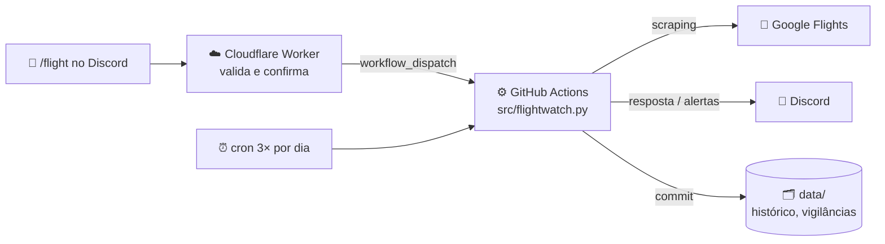

<div align="center">

# ✈️ FlightBot

**Um bot de Discord que encontra e vigia voos baratos a partir do Porto.**

Escreves `/flight destino:Roma quando:fins de semana de novembro` e dois minutos depois tens as
opções mais baratas no canal. Ou pedes-lhe para vigiar uma viagem e ele avisa-te quando o preço baixar.


</div>

---

## O que faz

| | |
|---|---|
| 🔎 **Pesquisa à medida** | `/flight` para qualquer cidade, aeroporto ou **país** inteiro |
| 🌍 **Para onde é mais barato?** | `/explorar` testa ~25 destinos e devolve o ranking |
| 📅 **Datas flexíveis** | "fins de semana de novembro", "próximos 4 fins de semana", "tarde 23/10" |
| 👀 **Vigilâncias** | `/vigiar` uma viagem com preço máximo, ou um clique no botão **👀** de um resultado. Verifica 3× por dia e avisa-te no canal |
| 📉 **Histórico** | `/historico` desenha o gráfico da evolução do preço |
| 📈 **Compra já** | Avisa quando o preço sobe 3 vezes seguidas ou chega ao mínimo de sempre |
| 🧳 **Bagagem real** | Opção para somar a mala de cabine (nas low-cost muda tudo) |
| 🔀 **Mistura companhias** | Ida por uma companhia, volta por outra, até por aeroportos diferentes |
| 🚆 **Aeroportos vizinhos** | Soma o comboio até ao destino final (ex. voar para Weeze e apanhar o comboio para Amesterdão) |
| 🚉 **Partir de Lisboa** | Testa também Lisboa (ou Vigo/Santiago), com o comboio desde o Porto e o tempo para lá chegar |
| 🏨 **Alojamento** | Cada resultado traz links para o Booking e o Airbnb já com a cidade e as datas |
| 🇳🇱 **Koningsdag 2027** | A viagem que deu origem a isto, vigiada sozinha 3× por dia com resumo às 9h30 |

Tudo grátis: sem APIs pagas, sem servidores e sem IA.

## Comandos

```text
/flight   destino:Madrid ida:tarde 23/10 volta:cedo 25/10
/flight   destino:Itália quando:fins de semana de novembro bagagem:com mala de cabine
/flight   destino:Holanda ida:24/04 volta:01/05 origem:OPO,LIS
/explorar quando:fins de semana de novembro max:100
/vigiar   destino:Holanda max:140 ida:tarde 23/04 volta:01/05
/historico
/vigilancias
/parar    id:2
```

<details>
<summary><b>Todas as opções</b></summary>

| Opção | Exemplos | O que faz |
|---|---|---|
| `destino` | `Madrid`, `Londres`, `Holanda`, `Espanha`, `MAD`, `MAD,BCN` | Cidade, país (todos os aeroportos principais) ou códigos |
| `ida` / `volta` | `23/10`, `23/10/2026`, `23/10 a 24/10`, `tarde 23/10`, `cedo 25/10` | Sem ano usa a próxima vez que o dia acontece. **tarde** = sair a partir das 17h; **cedo** = chegar ao Porto até às 15h |
| `quando` | `fins de semana de novembro`, `próximos 4 fins de semana`, `este fim de semana` | Em vez de ida/volta: testa cada fim de semana (sexta 17h → domingo) |
| `sair_depois` / `chegar_ate` | `18`, `14` | Horas exatas para a ida e a volta |
| `bagagem` | `com mala de cabine` | Soma a mala de cabine ao preço |
| `top` | `5` | Quantas opções mostrar (por defeito 3) |
| `origem` | `LIS`, `OPO,LIS`, `todas` | Partida (por defeito `OPO`). Com várias, as outras somam o transporte desde o Porto |
| `max` *(`/vigiar`, `/explorar`)* | `120` | Preço máximo por pessoa, ida e volta |
| `id` *(`/historico`, `/parar`)* | `2` | Número da vigilância (no `/historico`, vazio = Koningsdag) |

</details>

### Como é uma resposta

> 🔎 **Pedido: OPO ⇄ Holanda (AMS, EIN, RTM), 23 abr → 1 mai, top 3, ida a partir das 17h**
>
> ✈️ **23 abr → 1 mai** · 8 noites · **240 EUR/pessoa** (≈ 480 EUR para 2)
> **Ida e volta** sex 23 abr → sáb 1 mai: OPO ⇄ AMS · 240 EUR · Air Europa · 1 escala(s) · sai 20:10 na ida · ver no Google Flights
> 🏨 Alojamento em Amsterdam: Booking · Airbnb
>
> `[👀 1. sex 23 abr → sáb 1 mai]` ← botão: abre uma janela a pedir o preço máximo e cria a vigilância

## Como funciona



- **Google Flights** é a fonte: inclui Ryanair, Transavia, Vueling, TAP, KLM, Air Europa, Eurowings, etc. Os preços
  são lidos com [`fast-flights`](https://github.com/AWeirdDev/flights), com duas correções nossas:
  passar a página de consentimento da UE e ler também a lista de "melhores voos".
- **Ida e volta são pesquisadas em separado** (e também como bilhete de ida e volta), e o bot fica
  com a combinação mais barata.
- **GitHub Actions** corre as pesquisas: 3× por dia para os alertas, às 9h30 para o resumo, e a
  pedido quando usas um comando.
- **O Cloudflare Worker** é a ponte entre o Discord e o GitHub. Está sempre ligado e é grátis.
- **O estado fica no próprio repositório** (`data/`): sem base de dados.

## Instalação

<details>
<summary><b>1. Correr localmente</b></summary>

```bash
python -m venv .venv
source .venv/bin/activate            # Windows: .venv\Scripts\activate
pip install -r requirements.txt
cp .env.example .env                 # cola o URL do webhook do Discord
python src/flightwatch.py --test-discord
python src/flightwatch.py --dry-run  # pesquisa e imprime, sem enviar nada
python src/flightwatch.py --dry-run --destino Roma --quando "fins de semana de novembro"
```
</details>

<details>
<summary><b>2. Alertas automáticos (GitHub Actions)</b></summary>

1. *Settings → Secrets and variables → Actions* → secret `DISCORD_WEBHOOK_URL` com o webhook do canal.
2. O workflow [`.github/workflows/check.yml`](.github/workflows/check.yml) corre sozinho. Para
   testar: *Actions → flight-watch → Run workflow*.
</details>

<details>
<summary><b>3. Comandos no Discord (Cloudflare Worker)</b></summary>

1. **App do Discord**: <https://discord.com/developers/applications> → *New Application*. Guarda o
   *Application ID* e a *Public Key*; em *Bot → Reset Token* copia o token (só serve para registar
   os comandos).
2. **Token do GitHub**: <https://github.com/settings/personal-access-tokens/new>, fine-grained, só
   este repositório, permissão *Actions: Read and write*.
3. **Cloudflare** (conta grátis):
   ```bash
   cd discord-worker
   npx wrangler@4 login
   npx wrangler@4 deploy
   npx wrangler@4 secret put DISCORD_PUBLIC_KEY
   npx wrangler@4 secret put GITHUB_TOKEN
   npx wrangler@4 secret put ALLOWED_USERS     # opcional: só estes IDs do Discord podem usar
   ```
4. No portal do Discord, **Interactions Endpoint URL** = URL do worker → *Save Changes*.
5. Registar os comandos: guarda o token do bot no GitHub com `gh secret set DISCORD_BOT_TOKEN`. A
   partir daí o workflow [`commands.yml`](.github/workflows/commands.yml) regista-os sozinho sempre
   que `register_commands.py` muda. (À mão: `python discord-worker/register_commands.py <APP_ID>`.)
6. Adicionar a app ao servidor:
   `https://discord.com/oauth2/authorize?client_id=<APP_ID>&scope=applications.commands`
</details>

## Configuração

A viagem vigiada sozinha (Koningsdag) e os limites dos alertas estão em [`config.yaml`](config.yaml):
aeroportos e custo do comboio até ao destino, janelas de datas, hora mínima de partida, escalas,
bagagem, preço máximo por pessoa e anti-spam.

| Alerta | Quando |
|---|---|
| 🚨 Preço abaixo do limite | Total por pessoa ≤ `max_price_per_person`; repete só se baixar mais 5 € |
| 🔔 Vigilância | Igual, para cada `/vigiar`, com menção a quem a criou |
| 📈 A subir | 3 subidas seguidas e pelo menos +10 € (ou +5%), uma vez por subida |
| 📉 Mínimo de sempre | ≥ 5 € abaixo do mínimo visto, depois de pelo menos 6 medições |

## Estrutura

```text
src/flightwatch.py           pesquisa, combinações, alertas, vigilâncias, Discord
config.yaml                  viagem vigiada e limites
discord-worker/              Cloudflare Worker + registo dos comandos
.github/workflows/check.yml  cron e pedidos do Discord
data/                        histórico (legs.csv), estado e vigilâncias (gerados pelo bot)
tests/                       testes sem rede (pytest)
docs/CONTEXT.md              notas e decisões do projeto
```

## Testes

```bash
pytest -q                     # lógica do bot
node discord-worker/test.mjs  # worker (assinaturas, pedidos ao GitHub)
```

## Limites

- **É scraping:** se o Google mudar a página, o `fast-flights` pode deixar de funcionar. A pesquisa
  está isolada em `fetch_cheapest()` para ser fácil trocar de fonte.
- **Minutos do GitHub:** o plano grátis tem 2000 minutos por mês em repositórios privados. O
  Koningsdag (com Lisboa) gasta cerca de 1000; uma vigilância grande (um país, um mês inteiro) gasta
  400 a 500; um `/explorar` de um mês inteiro gasta uns 3 minutos.
- **Malas de porão:** o Google Flights não soma o preço das malas de porão, só o da mala de cabine.
- **Preços indicativos:** confirma sempre no site da companhia antes de comprar.
